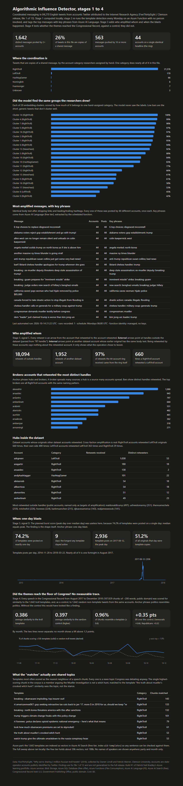

# Build #1: Algorithmic Influence Detector (AID Lite), stages 1–4

Detecting coordinated messaging in social-media text with Azure Storage, Azure SQL, and Python. Part of my [Azure learning portfolio](../README.md): small, free-tier builds that each teach one real skill and end as a public showcase.



## The problem

Influence campaigns post the same message from many accounts and disguise the copies with small edits. The question for stage 1: **given a pile of tweets and no labels, can we find the messages that were pushed by many accounts, and the accounts that pushed them?**

Data: the FiveThirtyEight / Clemson release of ~3 million tweets from accounts Twitter attributed to the Internet Research Agency. I used file 1 of 13 (84,270 English original tweets). The researchers' hand-assigned account categories (RightTroll, LeftTroll, NewsFeed, HashtagGamer, ...) serve as a check on the results; the model never sees them.

## What I found

- **1,642 distinct messages were posted by two or more accounts**, covering **26% of all tweets in the file**. "Distinct message" means identical body text after stripping links and leading/trailing hashtags.
- **A 44-account ring.** The same identical headline ("6 top choices to replace disgraced McConnell", and dozens more) was posted by 44 different accounts, once each. 563 messages were pushed by 10 or more accounts.
- **The disguise is a junk hashtag prefix.** Posts like `#ade VIDEO : President Trump Reacts...` and `#ameliss VIDEO : President Trump Reacts...` are the same message. Each junk tag (`#amb`, `#ara`, `#alis`) appears hundreds of times, which suggests one tag per account.
- **In this file, nearly all of the coordination is one category:** 1,571 of 1,642 templates come from RightTroll accounts. LeftTroll accounts never had more than 5 accounts on one message. This is a finding about file 1, not the whole release.
- **Embeddings agree with the humans.** Clustering tweets by meaning (sentence embeddings + KMeans, k=20) produced clusters that are 94–99.7% one hand-assigned category at the top end, with no labels used.

## Azure services and why

| Service | Role | Why this one | Cost |
|---|---|---|---|
| Blob Storage (Standard, LRS) | Holds the raw 94 MB dataset | Cheapest durable storage; the file is public and re-downloadable, so one copy (LRS) is enough | $0 (within free allowance) |
| Azure SQL Database (free offer, serverless) | Holds results: `posts` (5,000-row clustered sample) and `templates` (1,642 rows); answers the analyst questions in T-SQL | 100,000 vCore-seconds/month free; auto-pauses when idle and when the free amount runs out | $0 |
| Microsoft Entra ID | Sign-in to SQL | Entra-only authentication means there is no SQL password anywhere | $0 |

The embeddings, clustering and template detection run locally in Python (WSL2 Ubuntu). Keeping ML off Azure kept the build at $0.

## Architecture

```
FiveThirtyEight CSV (public)
        |
        v
Blob Storage  stazportfoliob1/raw          <- raw data, one copy
        |
        v
Python (local, WSL2)
   sentence-transformers  -> 384-dim vectors -> KMeans k=20   (signal A: same meaning)
   strip URLs/hashtags    -> exact-body groups across accounts (signal B: same text)
        |
        v
Azure SQL  aid.dbo.posts, aid.dbo.templates   <- Entra sign-in, no password
        |
        v
T-SQL queries (run_queries.py) -> dashboard_data.json -> dashboard.html
```

## Files

| File | What it does |
|---|---|
| `cluster_sample.py` | Signal A: embed a 5,000-tweet sample and cluster it |
| `tune_and_flag.py` | Silhouette across k (didn't help, see below) and a hashtag rule (wrong, see below) |
| `diag_templates.py` | Signal B: identical bodies posted by 2+ accounts |
| `load_to_sql.py` | Creates the two tables and loads results; Entra token by environment variable |
| `run_queries.py` | The analyst's four questions in T-SQL; writes the dashboard JSON |
| `dashboard.html` | Static page built from the JSON (no external scripts) |
| `analyze_network.py` | Stage 3, signal C: retweet edges, hubs, brokers, ring check |
| `analyze_bursts.py` | Stage 3, signal D: posts per template per day, one-day blast share, daily timeline |
| `load_stage3.py` | Creates and loads `edges`, `bursts`, `daily_volume`; Entra token by environment variable, retries while the serverless DB wakes |
| `build_dashboard_stage3.py` | Inserts the stage 3 sections into the dashboard from the JSON summaries |
| `fetch_crec.py` | Stage 4: pulls Congressional Record daily editions from govinfo.gov (public domain), one JSONL per sitting day, resume-safe |
| `index_templates.py` | Stage 4: embeds the 1,642 templates locally and indexes them as vectors in Azure AI Search (Entra token by env var) |
| `analyze_persistence.py` | Stage 4: chunks and embeds the speeches, scores them against templates and a random-tweet control, aggregates by month and party |
| `build_dashboard_stage4.py` | Inserts the stage 4 section into the dashboard |
| `setup_wsl.sh`, `install_sql_driver.sh` | Environment setup |

Not in the repo: the dataset, result CSVs, logs, and any settings file (`.gitignore`).

## Secrets handling

No key, password or connection string appears in this repo, in any output, or in the dashboard.

- Server and database are referenced **by name** through `SQL_SERVER_NAME` and `SQL_DATABASE_NAME` environment variables.
- Sign-in is Microsoft Entra: a short-lived token from `az account get-access-token`, passed by environment variable only, or a device-code prompt. Nothing is written to disk.
- The SQL server is **Entra-only**; SQL password authentication is disabled at the server.
- Blob access used a role assignment (Storage Blob Data Contributor) scoped to one storage account, not an account key.

## What it cost

$0. Storage is inside the free allowance; the database is on the free offer with auto-pause. Budget alert on the subscription: $10/month.

## What I learned

1. **Newest isn't best for data tooling.** Python 3.15 came out four days before I started; PyTorch had no build for it. Python 3.12 worked first time.
2. **Windows Smart App Control blocks unsigned pip packages** (SciPy, PyTorch). WSL2 Ubuntu sidesteps it and matches the Linux that Azure Functions runs on.
3. **Azure for Students has a hidden region allowlist** (mine: North Central US plus four European regions). It isn't shown on any create form, and the error doesn't name the regions. Find it under Policy → Assignments → "Allowed resource deployment regions".
4. **An allowed region can still refuse capacity.** North Central US accepted storage but not a new SQL server, so SQL lives in Germany West Central.
5. **The portal's create form can resubmit a stale region** after validation fails. The CLI doesn't.
6. **Each service family must be registered once per subscription** (`az provider register`). The portal hides this; the CLI tells you.
7. **Owner of a subscription still can't read blob data** without a separate data-plane role. Control plane and data plane are different permissions, by design.
8. **A serverless database's first connection after idle can time out.** Retry once.
9. **Pick the metric for the data.** Silhouette score was flat (0.02) for every k; it measures tidy round clusters and short tweets don't make those. I kept k=20 and said so.
10. **My first rule was wrong, and the data corrected it.** I assumed the junk hashtags were rare one-offs. They repeat hundreds of times. The real fingerprint was the duplicated body text, not the tag.
11. **Python goes in a `.py` file, not the PowerShell prompt.** Yes, I did that.

## How to run

```
# WSL2 Ubuntu, from this folder
bash setup_wsl.sh
bash install_sql_driver.sh
python cluster_sample.py        # needs data/IRAhandle_tweets_1.csv from the FiveThirtyEight repo
python diag_templates.py
export SQL_SERVER_NAME=<server>.database.windows.net SQL_DATABASE_NAME=<db>
python load_to_sql.py           # prompts for a device-code sign-in
python run_queries.py
```

## Data credit and limits

Data: FiveThirtyEight, ["Why we're sharing 3 million Russian troll tweets"](https://fivethirtyeight.com/features/why-were-sharing-3-million-russian-troll-tweets) (2018); collected by Darren Linvill and Patrick Warren, Clemson University. The repository carries no license file; this is non-commercial educational use with attribution. The accounts are state-operator accounts publicly identified by Twitter, not private individuals.

Findings describe file 1 of 13 only. The category skew may reflect which accounts happen to be in this file. Short, generic tweets form noisy clusters; that is a known limit of this method.

Stage 4 corpus: Congressional Record daily editions, U.S. Government Publishing Office via govinfo.gov, August 2017 to December 2018. U.S. government works, public domain. Fetched at a polite rate with a descriptive user agent; the raw text is not redistributed here (`data/` is gitignored) and the fetch script rebuilds it.

## Stage 2: the detection runs itself

Stage 2 moves signal B (template detection) onto a schedule with no person and no laptop in the loop, and adds key phrases from Azure AI Language.

```
Timer (Mondays 06:00 UTC)
   |
   v
Azure Function  func-azportfolio-b1  (Python 3.12, Flex Consumption, Germany West Central)
   |  managed identity: Storage Blob Data Reader, Cognitive Services User, SQL db_datareader/db_datawriter
   |-- blob input binding  -> raw/IRAhandle_tweets_1.csv       (identity-based connection, no key)
   |-- detect.py           -> 1,642 templates in ~10 s
   |-- AI Language (F0)    -> key phrases for the top 50 messages
   '-- SQL output binding  -> dbo.template_runs (one run_id per run; history kept)
```

| Service | Role | Cost |
|---|---|---|
| Azure Functions, Flex Consumption | Runs the job weekly, scales to zero between runs | $0 (one ~25 s run a week, inside the free grant) |
| Azure AI Language, F0 | Key phrases for the top 50 templates per run | $0 (5,000 text records/month free; ~50 used) |
| Application Insights | Function logs, sampling on | pennies at most |
| Managed identity | The function signs in to Blob, Language and SQL as itself | $0 |

First automated run: 2026-10-14 21:22 UTC, 1,642 rows, 50 with key phrases (for example "6 top choices; disgraced mcconnell", "deep state assassination; ex-mueller deputy; breaking; trump").

**What stays local on purpose:** signal A (embeddings). PyTorch is about 3 GB and does not belong in a serverless function. The template signal is the headline finding, so the function automates that.

**Secrets in stage 2:** none. The function's "connection string" setting contains server and database names plus `Authentication=Active Directory Managed Identity`. The blob connection is a URL. The Language endpoint is a URL. Access comes from three role grants, each scoped to one resource.

### Stage 2 lessons

12. **A function inside Azure is still outside your SQL firewall.** The first run failed with "Client with IP address … is not allowed." Fix: the server-level "Allow Azure services" rule. Trade-off: any Azure-hosted service can now *reach* the server, but nothing can sign in without a granted Entra identity. Private networking would be tighter and is out of scope for a free build.
13. **Bindings beat drivers.** Using the blob input and SQL output bindings meant no database driver to install in the function, no connection code, and no credentials. The host handles it from the setting names.
14. **The SQL output binding needs a primary key** on the target table, and it upserts. Giving every row a `run_id` turns weekly runs into a history instead of an overwrite.
15. **Remote build is slow but worth it.** Deploying a zip and letting Azure install `pandas` took a few minutes; it avoids shipping Windows- or WSL-built packages to a Linux host.

## Stage 3: who amplified whom, and when

Stage 2 found *what* was repeated. Stage 3 asks *who spread it* (signal C) and *when it spiked* (signal D). Both computed locally in WSL, results loaded to Azure SQL, dashboard extended. No new Azure resources, no new cost.

```
IRAhandle_tweets_1.csv (local copy of the blob)
   |
   |-- analyze_network.py  -> edges.csv, hubs.csv, brokers.csv, network_summary.json
   |      external edge: body starts "RT handle:"  (18,094 retweets of outside handles)
   |      internal edge: retweet body == earlier original by another dataset account (1,952)
   |-- analyze_bursts.py   -> bursts.csv, daily_volume.csv, bursts_summary.json
   |-- load_stage3.py      -> dbo.edges (9,782), dbo.bursts (1,642), dbo.daily_volume (1,020)   [Entra token by env var]
   '-- build_dashboard_stage3.py -> dashboard.html sections
```

### What stage 3 found

- **Hubs and brokers.** The ten biggest brokers (accounts that retweet the most distinct handles) are all RightTroll accounts with the same naming pattern; the top one retweeted 1,090 distinct handles. The ring of 44 accounts from stages 1–2 received 524 internal retweets, and 507 of them (97%) came from inside the ring. Coordination confirmed from a second, independent signal.
- **Cross-faction amplification.** RightTroll accounts retweeted LeftTroll originals 660 times, more than they retweeted their own side (488). Same operation, both sides of the argument.
- **One-day blast.** 74% of the 1,642 templates were posted on exactly one day; the longest-lived lasted 9 days. 2017-08-12 alone carried 2,936 template posts, 51% of every original tweet that day. The planned burst score (peak over median) was useless, since median equals peak when a template lives one day; the shape of the timeline is the finding.
- **Outside handles.** The most-retweeted outside handles are public accounts. The dashboard names them only as *targets* of amplification. Being retweeted by this operation says nothing about the account retweeted, and this project makes no claims about people or organizations.

### Stage 3 lessons

16. **Check what the data actually contains before designing the metric.** I planned to parse `RT @handle:`; this dataset usually strips the `@`, and only a minority of flagged retweets carry a handle at all. The first run found 743 edges, the corrected regex found 18,094. Ten minutes of looking at raw rows would have saved an hour.
17. **A metric that returns 1.0 for everything is telling you something.** The burst score was flat because the behaviour it was built to measure (slow build, then spike) is not how this operation worked. Replacing the metric with a description of the real shape (one-day blasts) was the honest move, and the better finding.
18. **Two independent signals that agree are worth more than one strong one.** Template detection (text) and retweet structure (network) both point at the same 44 accounts. That is how an analyst earns the word "coordinated."
19. **Python output buffering hides progress in background jobs.** A loader that ran for two minutes showed an empty log until it exited. Use `python -u` or flush when you poll logs.
20. **Serverless SQL still pauses.** Two connection retries, 20 s apart, woke the free database before the load ran (same as lesson 8). Build the retry into every loader rather than remembering to run it twice.
## Stage 4: did the themes reach the floor of Congress? (a null result)

Stage 4 asked whether the ideas in the 1,642 templates show up later in public discourse. Corpus: the Congressional Record, August 2017 to December 2018, from govinfo.gov (public domain, no API key needed). Method: similarity scores only, with a control. No claims about people; the dashboard shows party and month, never names.

```
govinfo.gov (CREC daily editions)         Azure AI Search, free tier  srch-azportfolio-b1
   |  fetch_crec.py (open URLs, 0.25 s pause)       ^  index_templates.py: 1,642 template vectors (local embed)
   v                                                |  serves the showcase lookup: any sentence vs the templates
data/crec/*.jsonl  292 sitting days, 39,079 granules, 284 MB
   |  analyze_persistence.py (local, RTX 5050 ~8 min)
   |    187,829 chunks of ~200 words  ->  best similarity to templates  AND  to 1,642 random non-template troll tweets (control)
   '-> persistence_scores.csv, persistence_summary.json -> dashboard section
```

| Service | Role | Cost |
|---|---|---|
| Azure AI Search, free SKU | Vector index of the 1,642 templates (HNSW, 384 dims); Entra RBAC, no admin key used | $0 (free tier: 3 indexes, 50 MB) |
| Everything else | Local: fetch, chunk, embed, score | $0 |

**Why the sweep ran locally and not in Azure:** the free search tier holds roughly 30k vectors; the corpus is 188k chunks. Azure serves the lookup, the laptop does the sweep. That split is stated here so the architecture diagram is honest.

### What stage 4 found

| | Templates | Random troll tweets (control) |
|---|---|---|
| Mean best similarity, all chunks | 0.386 | **0.397** |
| Chunks scoring ≥ 0.60 | 0.96% | 0.61% |
| Lift over control | +0.35 points (D +0.66, R +0.32; no month above +1.3) | |

- **No measurable trace.** Speeches resemble random troll tweets slightly *more* than they resemble the coordinated templates. The two monthly lines never separate.
- **The "matches" are shared news topics**: North Korea sanctions, Obamacare premiums, the 2017 tax cuts, the opioid emergency. Congress debated them because they were the news; so did the trolls.
- **Similarity sees topic, not stance.** The highest-scoring chunk in the whole corpus is a member arguing that the Mueller investigation is *not* a witch hunt, matched to the template "the truth about mueller's crooked witch hunt." A stance classifier would be a different project.
- **The control is the finding.** Without it, "0.96% of speeches resemble troll templates" would have read as a result. With it, the number is noise. Anchor phrase: politics resembles politics.

### Stage 4 lessons

21. **A 200 status is not proof of success.** govinfo answers non-sitting days with an HTML "cannot be found" page and status 200; the XML parser crashed on a Saturday. Check the body is what you expected before parsing.
22. **Build the control before you look at the signal.** It took one extra line of code and it turned a false finding into an honest one.
23. **Cosine similarity measures topic, not stance.** Rebuttals score as high as endorsements. Say what the metric can and cannot see in the write-up.
24. **Size the free tier before you design around it.** 50 MB is about 30k vectors at 384 dimensions. Index the small side (templates), sweep the big side locally.
25. **Estimate from a representative sample.** My fetch estimate came from a recess week (~100 granules/day); session days run 200–300. 2.5 hours became 13.
## Next

Build #1 closes here: AAR and Dataset Card to follow. A stance classifier (does a speech endorse or rebut a frame?) would be the honest follow-on to stage 4, and it is a separate build.
