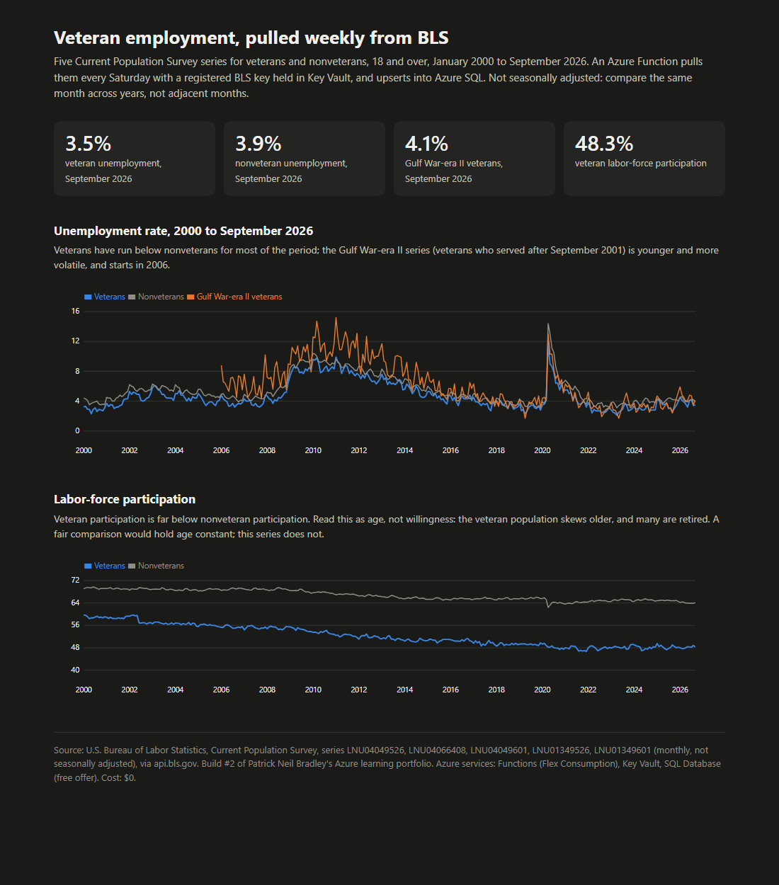

# Build #2: Veteran employment pipeline (BLS → Azure Function → Azure SQL)

A weekly, keyed pull of five public labor-market series into a queryable table, with the one secret handled the way secrets should be. Live page: `dashboard.html` (screenshot below).

## The problem

Veteran unemployment is reported monthly by BLS, buried in CPS table A-5. Nobody keeps a tidy time series of it next to the nonveteran rate. A Business Analyst's first job on any metric is to make it refresh itself, honestly labelled, in a place SQL can reach.

## What it does

```
BLS API v2 (registered key)                      Azure Key Vault  kv-azportfolio-b2
   ^                                                 ^  secret bls-api-key (set by the operator from their own shell)
   |  weekly, Saturdays 12:00 UTC                    |  read by the Function's managed identity (Key Vault Secrets User)
Azure Function  func-azportfolio-b2  (Python 3.12, Flex Consumption, Germany West Central)
   |  app setting BLS_API_KEY = @Microsoft.KeyVault(VaultName=kv-azportfolio-b2;SecretName=bls-api-key)
   |  app setting SqlConnectionString = names + Authentication=Active Directory Managed Identity
   '-- SQL output binding (upsert on PK) -> bls.observations in the free Azure SQL db "aid"
                                            bls.series (dictionary), PK (series_id, period), FK series_id
dashboard.html <- build_dashboard.py <- data/bls_observations.csv (same rows, exported locally)
```



## Series (verified at api.bls.gov, not from memory)

| Series | Measure | Population | Adjustment |
|---|---|---|---|
| LNU04049526 | Unemployment rate | Veterans, 18+ | NSA |
| LNU04066408 | Unemployment rate | Gulf War-era II veterans, 18+ | NSA |
| LNU04049601 | Unemployment rate | Nonveterans, 18+ | NSA |
| LNU01349526 | Labor-force participation rate | Veterans, 18+ | NSA |
| LNU01349601 | Labor-force participation rate | Nonveterans, 18+ | NSA |

All monthly, percent, January 2000 to the latest release (Gulf War-era II from 2006). Veteran data comes from the CPS, so "NSA" matters: compare the same month across years, not adjacent months. Veteran participation is far below nonveteran because the veteran population is older; the page says so rather than letting the chart imply the opposite.

## Azure services and why

| Service | Role | Why this one | Cost on Azure for Students |
|---|---|---|---|
| Azure Key Vault (Standard, RBAC) | Holds the BLS API key | The one secret in this build; the Function reads it by identity through a Key Vault *reference* in its app settings, so the key appears in no file, no setting value, and no chat | $0.03 per 10,000 operations; a weekly pull is a few operations a month, rounds to $0.00 |
| Azure Functions (Flex Consumption) | Weekly timer, SQL output binding | Scales to zero; the binding upserts on the primary key, so re-runs never duplicate | $0 inside the monthly free grant |
| Azure SQL Database (free offer) | `bls` schema in the existing `aid` database | One free database per subscription, so build #2 shares it under its own schema; the Function's user has SELECT/INSERT/UPDATE on that schema only | $0 |
| Application Insights | Function logs | Verifies each run (`bls_pull rows=… latest=… registered=True`) | pennies at most |

Delete at close: `az functionapp delete -n func-azportfolio-b2 -g rg-azportfolio-b1`; `az keyvault delete -n kv-azportfolio-b2 -g rg-azportfolio-b1` then `az keyvault purge -n kv-azportfolio-b2`; `DROP SCHEMA` after dropping the two tables.

## Secrets handling

- The BLS key was registered by the operator and stored with `az keyvault secret set … --value (Read-Host "Paste BLS key") --query name -o tsv` from the operator's own terminal: prompted, never echoed, never in this repo or in any chat.
- Verification used `az keyvault secret list` (names only), never `show`.
- `pull_bls.py` reads `BLS_API_KEY` from the environment if present and works unregistered if not (25 queries/day is enough for the one-time history load).
- SQL access from the laptop: Entra access token passed by environment variable, per build #1.
- `local.settings.example.json` holds placeholders and the Key Vault reference pattern.

## What it cost

$0.00. Key Vault is the only metered item and rounds to zero at this volume. Budget alert at $10 unchanged.

## How to run

```bash
# WSL2 Ubuntu, venv from build #1
python pull_bls.py                     # history to data/*.csv (set BLS_API_KEY for 20-year windows)
# SQL_ACCESS_TOKEN, SQL_SERVER_NAME, SQL_DATABASE_NAME by env, then:
python load_bls.py                     # creates schema bls and MERGE-upserts
python grant_function_db_user.py       # one-time: Function identity -> schema bls
python check_bls.py                    # counts, distinct keys, latest period
python build_dashboard.py              # dashboard.html
# deploy: zip function_app.py requirements.txt host.json -> az functionapp deployment source config-zip --build-remote true
```

## Files

| File | What it does |
|---|---|
| `pull_bls.py` | Pulls the five series from api.bls.gov to `data/` (key by env, optional) |
| `load_bls.py` | Creates `bls.series`, `bls.observations`; MERGE on (series_id, period); retries while the serverless db wakes |
| `grant_function_db_user.py` | Creates the Function's external-provider user with SELECT/INSERT/UPDATE on schema `bls` only |
| `check_bls.py` | Row count vs distinct keys (proves no duplicates), latest period and values |
| `build_dashboard.py` | Inline-SVG page from the CSV |
| `function/function_app.py` | Timer `0 0 12 * * 6`; BLS pull with the Key Vault-referenced key; SQL output binding |
| `function/local.settings.example.json` | Placeholders and the Key Vault reference pattern |

## What I learned

1. **A Key Vault reference is the whole trick.** The app setting's *value* is `@Microsoft.KeyVault(VaultName=…;SecretName=…)`; the platform swaps in the secret at runtime using the app's identity. The code just reads an environment variable.
2. **Set the secret from your own shell, prompted.** `(Read-Host "Paste key")` keeps it out of command history and out of any assistant's context; `--query name` keeps it out of the terminal output.
3. **Grant on the schema, not the database.** Build #1 gave its Function `db_datawriter` on everything. Build #2's Function can touch `bls.*` and nothing else. Same effort, smaller blast radius.
4. **Upsert on a real key, then prove it.** `MERGE` on (series_id, period) locally and the SQL binding's PK upsert in the cloud; `check_bls.py` shows rows == distinct keys after the Function ran over data that was already there.
5. **The BLS API says "-" for missing months and "M13" for annual averages.** Both arrive as ordinary data rows; filter before casting.
6. **Verify series IDs at the source.** FRED mirrors them with readable titles, but one unregistered API call confirmed all five exist and showed the latest period before any code was written.
7. **The cmd wrapper eats parentheses.** `az.cmd … --settings "KEY=@Microsoft.KeyVault(...)"` fails through the Windows wrapper; pass settings as a JSON file (`--settings @file.json`).
8. **Label the adjustment and the age mix, or the chart lies.** NSA series and an older population both need one sentence on the page.

## Data credit

U.S. Bureau of Labor Statistics, Current Population Survey, via the BLS Public Data API v2 (registered access). BLS data are public domain; the API terms of service apply to the key.