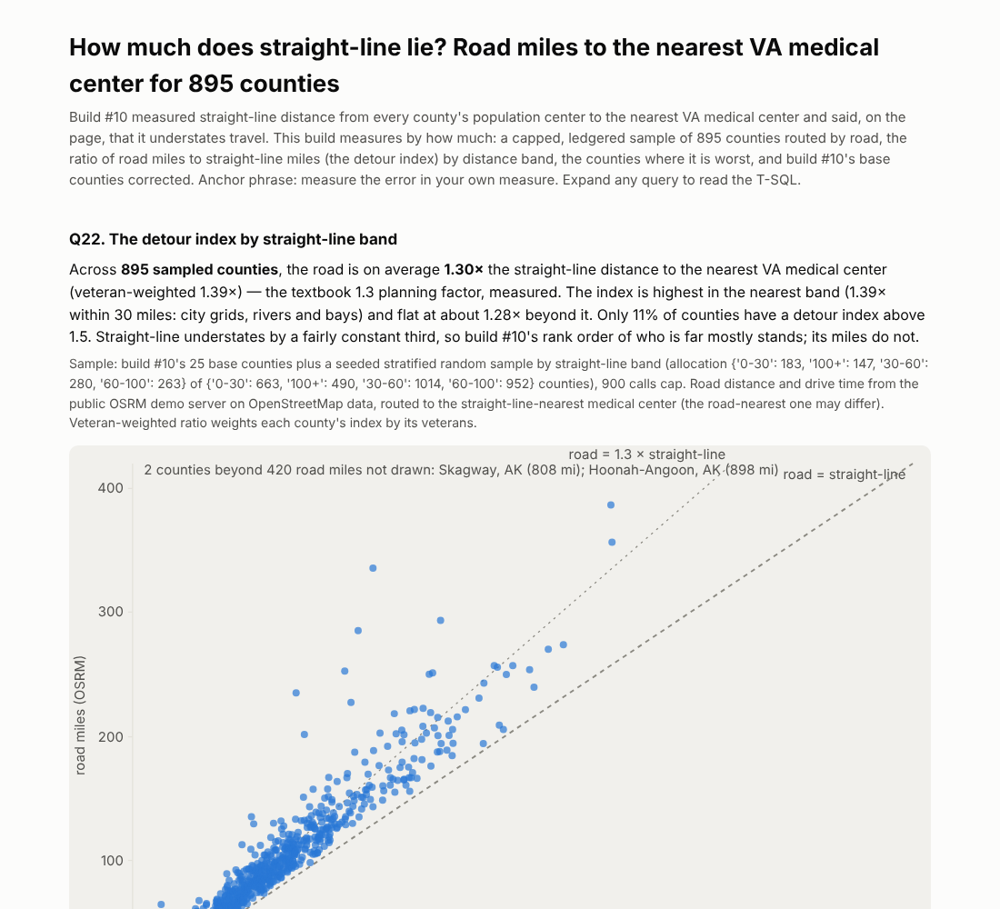

# Build #11: How much does straight-line lie? — road miles to the nearest VA medical center

**Anchor phrase: measure the error in your own measure.**

Live page: https://stazportfoliob1.z14.web.core.windows.net/build-11-road-distance/

*(This README was added at build #22. The build was published and closed on 2026-10-16 with the page, the queries and the data, but the folder's README was never committed. The showcase feed found the gap.)*

## The problem

Build #10 measured the distance from every county's population center to its nearest VA medical center as a straight line. Nobody drives a straight line. This build measures the error in that measure: road miles and drive minutes to the straight-line-nearest VAMC for a capped, stratified sample of counties, and the ratio between the two (the detour index).

**Answer:** road distance is about **1.30×** the straight line on average (1.39× weighted by veterans); 1.39× for counties within 30 miles, flattening to about 1.28× further out; 11% of sampled counties exceed 1.5×. The worst are water and mountain detours: Inyo CA 2.7×, Leelanau MI 2.6× (around Lake Michigan), Chugach AK 2.3×. Build #10's military-base counties keep their result: a clinic 1–27 miles away, a hospital 64–258 road miles away.

## Azure services used and why

| Service | Tier / cost | Why |
|---|---|---|
| Azure SQL (free offer, existing database `aid`) | free | `col.county_access` materialises build #10's spatial join once (3,144 rows); `col.route_ledger` holds one row per router call |
| Public OSRM demo server (OpenStreetMap, ODbL) | free, no key | road routing; 1 call/s, hard cap 900, user agent set, resume-safe ledger |
| Azure Maps | **refused by region policy** | Maps accounts cannot be created in any region the student subscription allows; nothing was created |

No new Azure resource. **Cost: $0.00.** The $10 budget alert was unchanged.

## Method

1. Materialise the nearest-neighbour join from build #10 into `col.county_access` (one spatial pass instead of three).
2. Sample: the 25 base counties from build #10's Q20 plus a seeded stratified sample by distance band (floor 150 per band) → 898 counties; 895 routed, 3 unroutable (Bristol Bay AK, Nome AK, Kalawao HI).
3. Route each county's population center to its straight-line-nearest VAMC through OSRM; write each call to a local JSONL ledger, then load the ledger with one OPENJSON insert. A second run makes 0 calls.
4. Queries Q22–Q26: detour index by band, worst counties, base counties, the mean, and the full routed table.

## What I learned

1. **Test the create before the plan.** Azure Maps failed on region policy the same way Static Web Apps had. Now every new resource type is tried with one `az ... create` before the plan is written.
2. **Materialise once.** Three queries re-running a spatial join cost three times the free compute.
3. **A ledger makes a capped external call resumable.** The SQL connection dropped mid-batch; the rerun loaded the ledger and made no new calls.
4. **Route to the k nearest, not the nearest.** The straight-line-nearest hospital is sometimes across a lake. Queued as build #21.

## Files

| File | What it does |
|---|---|
| `materialize.py` | builds `col.county_access` from build #10's join |
| `route_counties.py`, `route.sh` | the capped, ledgered OSRM routing |
| `queries.sql`, `run_analysis.py` | Q22–Q26 → `data/results.json` |
| `build_findings.py` | renders the page (inline SVG scatter: straight vs road miles) |

## Clean up

`DROP TABLE col.route_ledger` (optional; keep `col.county_access`, build #13's API serves it). Nothing in Azure to delete.

Data: OpenStreetMap contributors (ODbL) via the OSRM demo server; US Census; VA/HRSA station list. Non-commercial learning project. Built with Claude.
