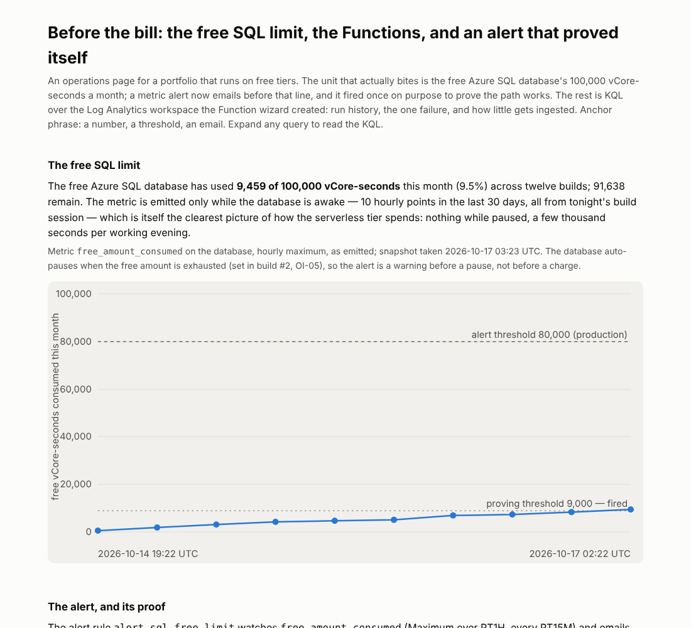

# Build #12: Before the bill — the free SQL limit, KQL over the Functions, and an alert that proved itself

**Anchor phrase: a number, a threshold, an email.**

Live page: https://stazportfoliob1.z14.web.core.windows.net/build-12-operations/

## The problem

Eleven builds on free tiers, and the only guardrail was the $10 budget alert — which fires on money, after the fact. The unit that actually bites here is the free Azure SQL database's **100,000 vCore-seconds a month**; when it runs out the database pauses until next month and every build stops. This build puts a number on it, watches it, and proves the warning reaches a person before the line.

**Answer:** 9,459 of 100,000 vCore-seconds used this month (9.5%) after twelve builds. A metric alert on `free_amount_consumed` now emails at 80,000. Set first to 9,000 so it would fire immediately, it **fired at 2026-10-17 03:20 UTC** and the email arrived; then the threshold was raised. The Functions have three invocations in the workspace so far (all manual tests; the schedules start this weekend); the one failure is the serverless pause seen from the other side. The workspace has ingested under 1 MB against 5 GB free.

## Azure services used and why

| Service | Tier / cost | Why |
|---|---|---|
| Azure Monitor metric alert `alert-sql-free-limit` | first 10 monitored time series/month free; this is 1 → $0 | `free_amount_consumed` > 80,000, max over 1 h, every 15 min |
| Action group `ag-azportfolio-ops` (one email receiver) | 1,000 emails/month free → $0 | the person at the end of the alert |
| Log Analytics workspace (default, PerGB2018, germanywestcentral) | first 5 GB/month free; ingesting KB → $0 | where both Function apps' Application Insights already stream |
| Application Insights ×2 (existing) | included | AppRequests, AppTraces, AppExceptions for both Functions |
| Azure Monitor workbook `azportfolio-operations` | free | one page: SQL free limit, runs per day, failures, ingestion (`workbook.json` in this folder) |
| Bicep (build #10's `infra/main.bicep`) | $0 | the two App Insights components, the action group and the alert rule added; what-if: components and action group `NoChange` |

Not used, on purpose: log-search alert rules (billed per rule). Nothing else created. **Cost: $0.00.**

## The KQL pack (`kql/`)

| # | Question | Pattern |
|---|---|---|
| K01 | What the workspace holds | `union isfuzzy=true … summarize by Type` |
| K02 | Every Function invocation, duration, outcome | `AppRequests`, `split(AppRoleName)` |
| K03 | Runs per Function per day (timer evidence) | `summarize … by bin(TimeGenerated, 1d)` |
| K04 | Failures and exceptions | `union` of failed requests and `AppExceptions` |
| K05 | Trace volume by severity (sampling weight) | `sum(ItemCount)` |
| K06 | Billable ingestion by table, 30 days | `Usage` table |

`run_kql.ps1` runs them against the workspace by name and saves `data/kql_results.json`; `snapshot.ps1` saves the metric series, the alert rule, the fired-alert record and the action group (names only) to `data/ops_snapshot.json`; `build_findings.py` renders the page from both.

## How the alert was proved

1. Create the action group (email receiver; the address is passed on the command line, the repo carries the group name).
2. Create the rule at a threshold already exceeded (`> 9000` when consumed was 9,294) so it must fire on first evaluation.
3. Wait one evaluation (15 min). Read the fired-alert record from Alerts Management; confirm the email.
4. Replace the condition with the production threshold (`> 80000`). The rule's description records the proving run.

Lesson: an alert that has never fired is a hypothesis. Fire it once on purpose.

## What I learned

1. **Alert on the unit that bites, not the dollar.** The budget alert watches money; the free SQL offer fails on vCore-seconds, silently, by pausing.
2. **Prove the path by firing it.** Threshold below the current value, wait, read the record, then set the real threshold.
3. **The wizard already built half the monitoring.** Both Functions' App Insights were streaming to a default workspace the whole time; KQL over it cost nothing and needed no new resource.
4. **Serverless pauses show up as exceptions.** Build #1's first run failed on a `SqlException` while the database woke; the retry four minutes later is the whole story of OI-05.
5. **The metric sleeps with the database.** `free_amount_consumed` has points only while the db is awake; a flat line means paused, not idle.
6. **KQL through two shells: one line, single quotes, no reserved words.** Newlines did not survive the argument, double quotes were eaten, and `kind` is a keyword.
7. **Workbook resource names must be GUIDs**, and the CLI's `az resource create` has no `--kind`; `az rest` PUT is the clean path.

## Cleanup

`az monitor metrics alert delete -n alert-sql-free-limit -g rg-azportfolio-b1`; `az monitor action-group delete -n ag-azportfolio-ops -g rg-azportfolio-b1`; the workbook: `az rest --method delete` on its resource id. The workspace and App Insights predate this build and stay.

## Files

| File | Purpose |
|---|---|
| `kql/K01–K06.kql` | the query pack |
| `run_kql.ps1`, `snapshot.ps1` | run the pack; snapshot metrics, rule, fired alerts, action group |
| `workbook.json` | the Azure Monitor workbook (serializedData) |
| `build_findings.py` | renders `findings.html` from the two JSON files |
| `data/kql_results.json`, `data/ops_snapshot.json` | committed |
| `../build-10-va-access/infra/main.bicep` | now also describes App Insights ×2, the action group and the alert |
