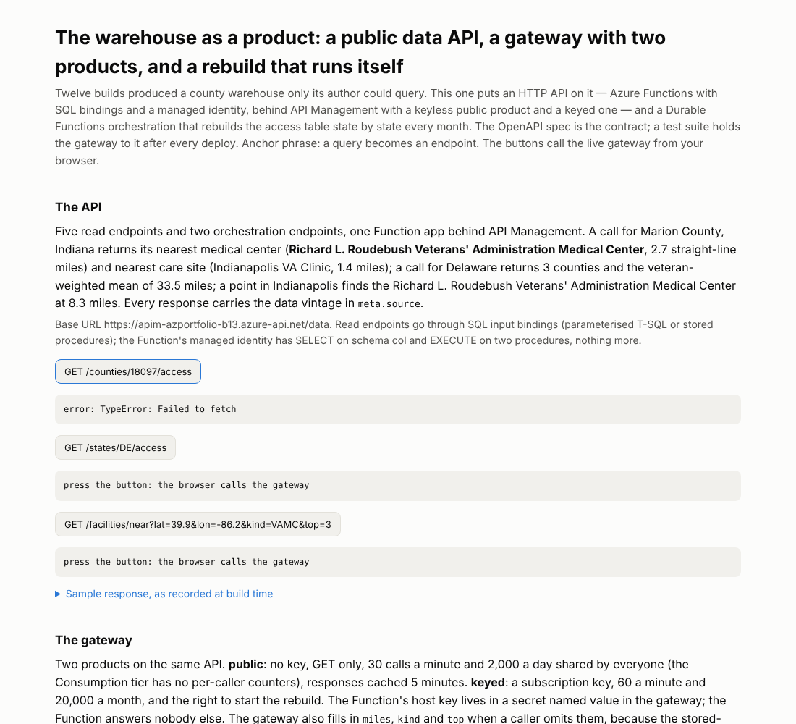

# Build #13: The warehouse as a product — a public data API, two gateway products, and a rebuild that runs itself

**Anchor phrase: a query becomes an endpoint.**

Live page (with buttons that call the API): https://stazportfoliob1.z14.web.core.windows.net/build-13-data-api/
API base: `https://apim-azportfolio-b13.azure-api.net/data` · spec: [`openapi.yaml`](openapi.yaml)

## The problem

Twelve builds produced a county warehouse (`col.*`) that only its author could query. A Business Analyst's deliverable is often not the analysis but the *data product*: a documented, governed way for other people and tools to get at the numbers. This build makes one, and it exercises four things the portfolio had not touched: HTTP API design in Azure Functions, API Management, Durable Functions, and contract tests in CI.

**What it does:** `GET /counties/{fips}/access`, `GET /states/{state}/access`, `GET /facilities/near?lat&lon[&miles&kind&top]` (a live spatial query), `GET /refresh/runs`; `POST /refresh` starts a Durable orchestration that fans out to 51 state activities, each rebuilding `col.county_access` for one state through a stored procedure, and fans in to a run record. The last run rebuilt **3,144 rows in 51 states** and the table matched build #10 to the row. The contract test passes **16/16 passed** against the live gateway.



## Azure services used and why

| Service | Tier / cost | Why |
|---|---|---|
| Azure Functions `func-azportfolio-b13` (Flex Consumption, Python 3.12) | free grant; $0 | HTTP endpoints via **SQL input bindings** (parameterised T-SQL and stored procedures) with the app's **managed identity** — no driver, no connection string value in code |
| Durable Functions (Azure Storage provider, task hub `azportfoliob13`) | storage transactions, fractions of a cent | fan-out / fan-in with retries; status endpoint; monthly timer. No always-ready instance (that bills); cold starts accepted |
| API Management `apim-azportfolio-b13` (Consumption) | first 1,000,000 calls/month free; $0 | the API imported from `openapi.yaml`; product **public** (no key, GET only, 30/min and 2,000/day shared) and **keyed** (subscription, 60/min, 20,000/month, may POST /refresh); backend locked with the Function host key held as a **secret named value**; CORS for the two sites; query-parameter defaults |
| Azure SQL `aid`, schema `col` | free offer; $0 | user `func-azportfolio-b13` (external provider) with SELECT on the schema and EXECUTE on two procedures; `col.refresh_run` |
| GitHub Actions | $0 | `tests/contract_test.py` runs after every deploy; a broken contract fails the build |

**Cost: $0** on every metered line; Durable's queue and table operations on the existing storage account are the first non-zero cents in the portfolio and are stated as such.

## How it fits together

```
browser / curl ──► API Management (products: public | keyed; policies: rate-limit, quota, CORS, defaults, x-functions-key)
                        │
                        ▼
              Azure Function app (managed identity) ──► SQL input bindings ──► Azure SQL `aid`.col
                        │
            Durable orchestration: refresh_orchestrator ─fan-out─► refresh_state × 51 (sp_refresh_access_state) ─fan-in─► run_record
```

## What went wrong, in order (the lessons are in here)

1. The root route `""` is not a valid Functions route → `/info`.
2. A stored-procedure binding fails when an optional query parameter is absent → the **gateway supplies defaults** (`set-query-parameter exists-action="skip"`); the proc treats empty `kind` as "any".
3. `exclusiveMinimum: 0` is OpenAPI 3.1; 3.0 wants a boolean → APIM import rejected the spec until fixed.
4. PowerShell's `Get-Content -Raw` string carries note properties; `ConvertTo-Json` serialised it as a 26 KB object → "policy exceeds 16 KB". Cast to `[string]`.
5. `rate-limit-by-key` / `quota-by-key` are **not allowed in the Consumption tier** → product-wide `rate-limit` / `quota`; the public limit is shared, and the page says so.
6. The first orchestration "completed" with **0 rows**: an activity with a plain-string input cannot be addressed by the SQL binding's `{state}` expression, so the procedure ran with an empty state. Fix: pass `{"state": "AL"}`; the activity now raises on zero rows so a silent no-op cannot look like success.
7. Out-of-range coordinates reached the proc before the code's validation → the proc returns nothing for bad input and the code answers 400.
8. The contract suite's 16 calls plus one stray call tripped the 20/min public limit → limit raised to 30/min, and the suite backs off once on 429.

## The contract

`tests/contract_test.py` — 16 checks: envelope shape, 200/400/404/405, a known value (Marion County IN → Roudebush VAMC, 2–4 miles), the gateway's defaults, ordering, the public product's refusal of POST, a response-time budget. Runs on the PC and in the workflow after every deploy.

## How to run

```
bash setup.sh                                   # one-time, as the operator: Function user, grants, procedures, refresh_run table
az functionapp deployment source config-zip ... # zip function/ → remote build (see the Build Log for the exact command)
# APIM: az apim api import --specification-path openapi.yaml ...; policies PUT from apim/*.xml via az rest (see Build Log)
python tests/contract_test.py                   # the contract, against the live gateway
python build_findings.py                        # the page
```

## What I learned

1. **Bindings are the driver.** SQL input bindings with a managed identity gave a read API with no secrets and no ODBC question.
2. **The gateway is where defaults, limits and keys live**, not the code. The Function never saw a subscription key or a missing parameter.
3. **A completed orchestration is not a successful one.** Make the activity fail on the outcome you care about (zero rows), not on exceptions alone.
4. **Tier limits are policy limits.** Consumption APIM has no per-caller counters; read the tier matrix before designing the product.
5. **The spec is the contract only if something enforces it.** The CI test is the enforcement.
6. **Test the create before the plan** — APIM Consumption in `northcentralus` passed this time; the plan said so before go.
7. **Two shells, again:** quote and cast everything that crosses PowerShell → az → JSON.

## Cleanup

`az apim delete -n apim-azportfolio-b13 -g rg-azportfolio-b1 -y`; `az functionapp delete -n func-azportfolio-b13 -g rg-azportfolio-b1` (its Flex plan goes with it); in SQL: `DROP USER [func-azportfolio-b13]; DROP PROCEDURE col.sp_refresh_access_state, col.sp_facilities_near; DROP TABLE col.refresh_run;`. The Durable task hub's blobs/queues/tables in `stazportfoliob1` are prefixed `azportfoliob13`.

## Files

| File | Purpose |
|---|---|
| `function/function_app.py`, `host.json`, `requirements.txt` | the API, the orchestration, the timer |
| `openapi.yaml` | the contract; imported into API Management; published with the page |
| `apim/policy-api.xml`, `policy-public.xml`, `policy-keyed.xml` | gateway policies, as stored |
| `sql_setup.py`, `setup.sh`, `check_access.py` | database user, grants, procedures, run table; the after-run check |
| `tests/contract_test.py` | the contract, run in CI |
| `build_findings.py` | the page, with live-call buttons |
| `data/sample_responses.json`, `data/contract_run.txt` | committed: responses as recorded, the test record |
