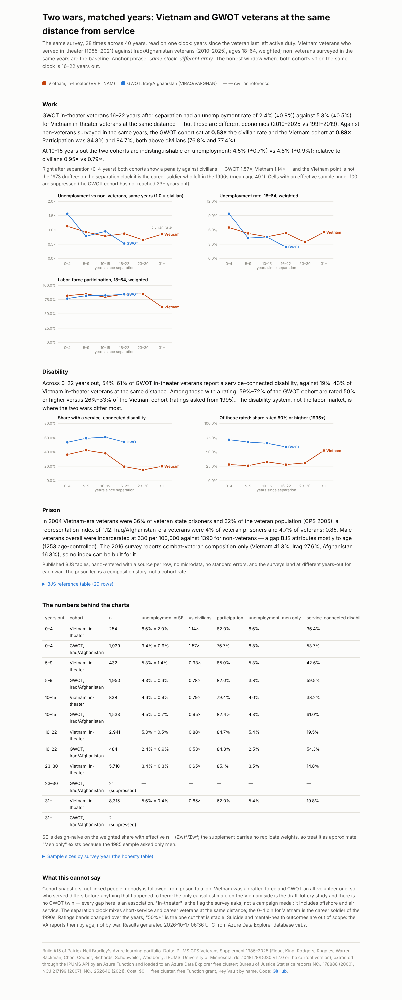

# Build #15 — Two wars, matched years: Vietnam and GWOT veterans at the same distance from service

**Live page:** https://stazportfoliob1.z14.web.core.windows.net/build-15-two-wars/
**Anchor phrase:** *same clock, different army.*

## The problem

Vietnam and GWOT veterans are usually compared at the same calendar moment, which is the same as comparing a 72-year-old with a 38-year-old. This build puts both cohorts on one clock — years since the veteran last left active duty — and asks whether, at the same distance from service, they differ on work, service-connected disability and incarceration, and how much of any gap the data can attribute to the war rather than to who served.

The answer, in one line: on work, the two wars look alike (same shape against civilians, GWOT slightly better at 16–22 years out); on disability they are different systems (GWOT in-theater veterans report a service-connected disability at roughly twice the Vietnam rate at the same distance, and their ratings are higher); on prison the published tables only support a composition index, and in 2004 both cohorts sat near 1.0.



## What was built

| Piece | Azure service | Why this one |
|---|---|---|
| Microdata store + analysis | **Azure Data Explorer free cluster** (`azportfolio`, db `vets`, table `cps_raw`, 3.58 M rows) | KQL over microdata at scale; the free cluster belongs to the signed-in account, not the subscription, so the student region policy cannot refuse it. 3.58 M rows ingest in about a minute. |
| Extract pipeline | **Azure Functions, Durable** (blueprint `bp_ipums.py` inside `func-azportfolio-b13`) | The async-job pattern: submit an IPUMS extract, poll on a durable timer (nothing sits awake), download to Blob, queued ingestion to ADX. Annual timer 15 Oct 04:00 UTC + `POST /api/ipums/extract`. |
| Secret | **Key Vault** `kv-azportfolio-b2`, secret `ipums-api-key`, app setting as a Key Vault reference | Same pattern as build #2; the key is never in code, chat or the repo. The app's identity holds Key Vault Secrets User. |
| Landing zone | **Blob** container `ipums/` | Every extract kept as `cps_<n>.csv.gz` + codebook, written with the app's identity (Storage Blob Data Contributor scoped to the container). |
| Cluster identity | ADX database principals | The Function's managed identity added as Ingestor + Viewer by `aadapp=<clientId>;<tenantId>`; ingestion stages through Kusto's own storage with that token — no SAS of ours. |
| Reference data | `reference/bjs_prison.csv` | Hand-entered BJS figures with a `source_url` on every row. |

```
IPUMS API ──submit──▶ [extract builds] ◀──poll (durable timer, 60 s)── Function (b13)
                                              │ completed
                                              ▼
                               Blob ipums/cps_<n>.csv.gz ──▶ ADX queued ingestion (tag extract:<n>)
                                                                        │
                      kql/functions.kql (vet_base: cohort, clock, outcomes) ──▶ adx_results.py ──▶ data/results.json ──▶ findings.html
```

## Method (the BA part)

`SPEC.md` was written before any data landed and changed twice after reading the files — both changes dated in its log.

- **Cohorts:** in-theater is primary (`VVIETNAM` = served in Vietnam, asked in all 28 samples; `VIRAQ`/`VAFGHAN`, asked from 2010). Era (`VWHEN`) is secondary because it starts in 2005 and "answered VVIETNAM" turned out to cover 1955–64 and Korea-era veterans too.
- **Clock:** `years_out = survey year − VLASTSERVE` (1991+), binned 0–4 … 31+. The honest overlap on the separation clock is 16–22 years out. 1985/1987 run on the era clock and are shown, not compared.
- **Outcomes:** unemployment and participation (18–64, `VTSUPPWT`), service-connected disability and 50%+ ratings, and the BJS prison tables. Every cohort rate is read against non-veterans surveyed in the same years, so 1991–97 and 2019–25 are not compared raw.
- **Rules that came from the data:** drop supplement non-respondents (weight 0) first; codes 96–99 are null; yes/no is 1/2 for `VIRAQ` but 2/1 for `VVIETNAM`; cells with effective n < 100 are suppressed; nothing is interpolated.

## What it cost

$0. The ADX free cluster is free (one year, renewable); the Function runs inside the existing app's free grant; Blob holds ~150 MB; Key Vault operations are fractions of a cent. $10 budget alert in place since build #1.

## What went wrong (and what it taught)

1. **The plan assumed variables I had not checked.** `VWHEN` does not exist before 2005; `VETSTAT` not before 1991. The extract's codebook carries the availability table — read it before the spec, not after.
2. **A flag with the same name is not the same universe.** "Answered VVIETNAM" looked like the era cohort and was not. Verified by cross-tabulating against `VWHEN` in 2023 before trusting it.
3. **Plan creates throttled.** The fifth Flex Consumption plan in two days was refused; Flex allows one app per plan, so the pipeline lives in build #13's app as a Durable blueprint. Recorded, not hidden.
4. **The IPUMS metadata API has no variable endpoint for CPS** (404 on every name). The submit endpoint validates names, so a one-sample extract was the test.
5. **`make_set()` order is not stable** across extents; the results file diffed after the Function's own ingestion replaced the hand load. Sorted the set; every number was identical.
6. **Inline Python through PowerShell → WSL** broke again on brackets. Script files only (lesson from build #8, relearned).
7. **A `sites/config` appsettings resource in Bicep replaces the whole bag.** The build #15 block in `main.bicep` documents the settings; deploying it as-is would drop the others. What-if shows Modify; the README says why.

## Lessons

1. **Same clock, different army.** Matching on years-out removes age; it cannot remove selection (draft vs volunteer).
2. **Read the availability table, not the variable list.**
3. **A cohort flag earns its place by cross-tab, not by name.**
4. **The free cluster is the one Azure resource the region policy cannot touch** — because it is not in the subscription.
5. **Async jobs want a durable timer**, not a Function awake for five minutes.
6. **Baseline in the same years or do not compare.**
7. **The disability system is where the two wars differ**, not the labor market.

## Cleanup (at close, if ever)

```
# ADX free cluster: dataexplorer.azure.com → My cluster → Delete (not an ARM resource)
az storage container delete --account-name stazportfoliob1 -n ipums --auth-mode login
az keyvault secret delete --vault-name kv-azportfolio-b2 -n ipums-api-key
# remove bp_ipums.py from build-13's function and redeploy; remove the seven IPUMS/ADX app settings
```

## Files

| Path | What |
|---|---|
| `SPEC.md` | the harmonisation spec, written first, with its change log |
| `../build-13-data-api/function/bp_ipums.py` | the Durable extract pipeline (lives in build #13's app) |
| `adx_setup.py`, `run_adx.sh` | table creation + first ingest from the PC (token by env) |
| `kql/functions.kql` | `vet_base()` and `wshare()` — every recode in one place |
| `adx_results.py`, `run_results.sh` | applies the functions, runs R1–R7, writes `data/results.json` (force-added) |
| `reference/bjs_prison.csv` | 29 hand-entered BJS rows with sources |
| `build_findings.py`, `findings.html`, `findings.png` | the page; every number computed from the two data files |

Data: IPUMS CPS Veterans Supplement 1985–2025 (Flood et al., IPUMS, University of Minnesota, doi:10.18128/D030.V12.0 or current), used under IPUMS' non-commercial research terms; BJS NCJ 178888, 217199, 252646. Non-commercial, Azure for Students.
