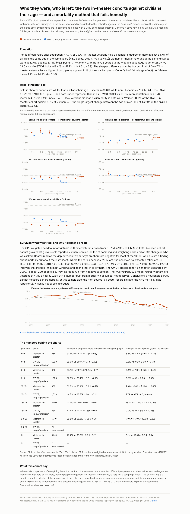

# Build #16 — Who they were, who is left: cohort profiles and a mortality method that fails honestly

**Live page:** https://stazportfoliob1.z14.web.core.windows.net/build-16-who-is-left/
**Anchor phrases:** *two shares, one interval* · *the weights are the headcount — until the answers change.*

## The problem

Build #15 put Vietnam and GWOT in-theater veterans on one clock. Two follow-ups: (A) who are they — education, race/ethnicity, sex — against civilians their age in the same years, with a proper test for "in line with the population"; (B) can the survey's own weights (which sum to the living population) tell us whether either cohort dies faster than the life table predicts?

(A) works. (B) does not, and the page says exactly why.



## What was built

| Piece | Azure | Why |
|---|---|---|
| Wider person table | ADX `vets.cps_person` (26 columns, 3.58 M rows) created **by the pipeline from the file's header** (`.create-merge table`) | IPUMS orders columns its own way; the header is the schema. A new file family now needs no hand setup. The blueprint takes a `table` name in the job. |
| Cohort base | **Materialized view** `vet_base_mv` (backfilled, async) | The cohort/clock/demographic aggregation is precomputed once and kept current as extents arrive; every result query reads the view. |
| Reference tables | `ssa_qx` (10,434 rows), `ssa_surv` (63,504 survival probabilities for every pair of survey years × sex × age), `vetpop` (1,488) | Inline ingestion; the survival join is a lookup, not a per-row function. |
| Identity | Function identity added as database **user** (create tables) | Ingestor could not create tables. |

## Method

- **Profiles:** cohort cell (years-out bin) vs non-veterans in the same survey years, **reweighted to the cohort's age mix** (18–34, 35–49, 50–64). Difference in points with 95% CI (`diff ± 1.96·√(SE₁²+SE₂²)`), representation index, Cohen's h.
- **Survival:** closed cohorts (Vietnam in-theater; GWOT in-theater separated by 2009), all ages. Observed deaths = weighted headcount at t₁ − t₂; expected = Σ wᵢ·(1 − Π(1 − q)) from the SSA period tables by sex, single age and calendar year, compounded across the gap. Ratio with an interval from the two endpoint counts.

## What it found

- Education: at 10–15 years out, both cohorts out-degree civilians their age (GWOT +6.0 pts, CI +3.1 to +9.0; Vietnam +8.6, CI +4.9 to +12.3); the Vietnam advantage is gone by 16–22 years out, GWOT's holds. Almost no GWOT in-theater veteran lacks a high-school diploma (1.1% vs 9.1%, h −0.40).
- Race/ethnicity/sex: both cohorts whiter than civilians their age (+5 and +9 pts); Hispanics under-represented (index 0.49 Vietnam, 0.70 GWOT); Black veterans at parity; women 11% of the GWOT in-theater cohort vs 1.6% of Vietnam's.
- Survival: the Vietnam in-theater weighted headcount **rises** 3.67 M → 4.17 M between 1985 and 1999. A closed cohort cannot grow; self-reported Vietnam service did. Where the series behaves (2007+), ratios are 0.7–3.0 with intervals that include 1.0 and each other. The GWOT closed cohort is ~200 people a survey. Verdict: a household survey cannot measure cohort mortality at this sample size; the right source is a death-record linkage, which is not public.

## What it cost

$0. Same free cluster, same Function app (free grant), ~80 MB more Blob. $10 alert in place.

## What went wrong

1. **Scripted downloads refused by ssa.gov** (container and PC alike). The browser pane fetched the four CSVs in page context and saved them to Downloads — the BLS pattern again.
2. **`.create-or-alter materialized-view` with backfill** must be `async`, and `create-or-alter` does not take `backfill` at all → `.create async ifnotexists materialized-view with (backfill=true)`; the view is not visible for a few seconds after the command returns.
3. **KQL join conditions take columns only** (`$right.rn - 1` is not allowed) → compute the shifted column first.
4. **Trailing comments after a function body** break the management command when statements are split by `.create` → cut each statement at its last `}`.
5. **Python 3.10 on the device VM** rejects nested same-quote f-strings (lesson from build #15, relearned within the hour).
6. **The survival idea**: the method was sound and the instrument was not. Finding that out cost one query and is the most useful line on the page.

## Lessons

1. **Two shares, one interval.** SD is for a spread within one group; two proportions want a difference with a CI, an index for "in line with", and h for "how big".
2. **Age-match the civilian reference** or the comparison is a comparison of ages.
3. **The weights are the headcount — until the answers change.** Self-report drift breaks a closed cohort.
4. **Materialized views are the right home for a cohort base** that gets rebuilt every annual extract.
5. **Let the pipeline create the table from the header.**
6. **A negative result stated plainly is a result.**

## Cleanup (at close, if ever)

```
.drop materialized-view vet_base_mv
.drop tables (cps_person, ssa_qx, ssa_surv, vetpop)
az storage blob delete --account-name stazportfoliob1 -c ipums -n cps_00004.csv.gz --auth-mode login
```

## Files

| Path | What |
|---|---|
| `SPEC.md` | addendum to build #15's spec, written before extract #4 |
| `../build-13-data-api/function/bp_ipums.py` | pipeline: `table` in the job; `ensure_table()` from the header |
| `load_reference.py`, `run_reference.sh` | SSA q(x) → `ssa_qx`, pairwise survival → `ssa_surv`, VetPop → `vetpop` |
| `kql/functions16.kql` | `person_base()` (readable) and the materialized view (served) |
| `adx_results16.py`, `run_results16.sh` | R8–R14 → `data/results.json` (force-added) |
| `reference/ssa/*.csv`, `reference/vetpop2023_period_of_service.csv` | reference inputs (public domain) |
| `build_findings.py`, `findings.html`, `findings.png` | the page |

Data: IPUMS CPS (non-commercial research terms; aggregates only in the repo); SSA period life tables (2023 TR); VA VetPop2023 (CC0). Non-commercial, Azure for Students.
