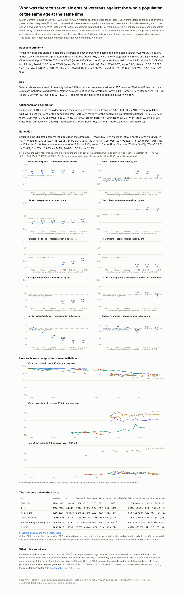
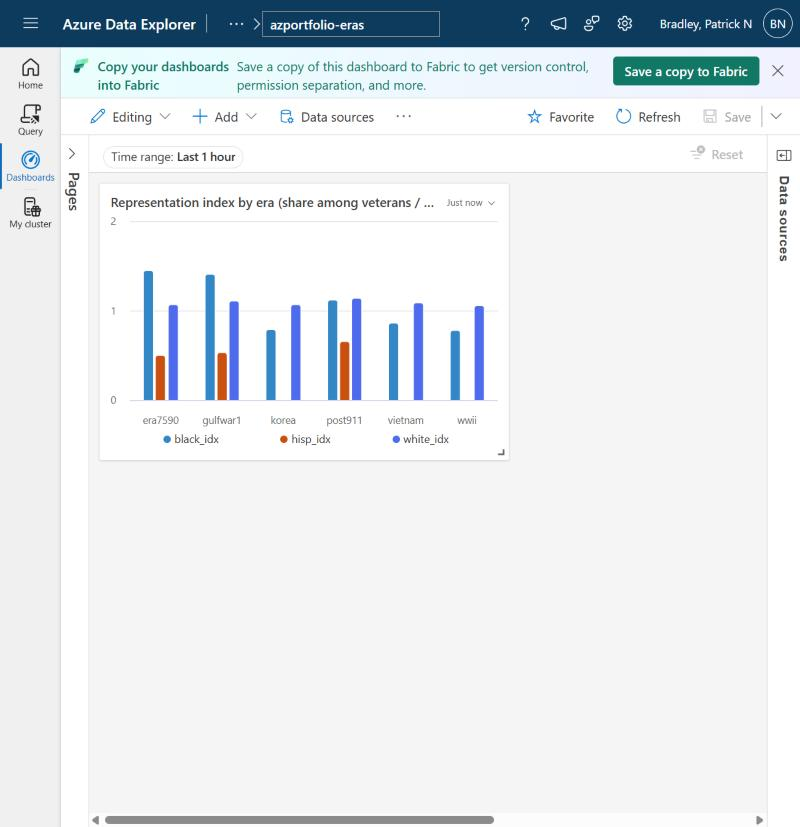

# Build #17 — Who was there to serve: six eras of veterans against the whole population of the same age at the same time

**Live page:** https://stazportfoliob1.z14.web.core.windows.net/build-17-five-eras/
**Anchor phrase:** *who served, against who was there.*

## The problem

"Was the military representative?" is usually answered with today's numbers, or with a political motive. This build answers a narrower, checkable question: for each era of service — WWII, Korea, Vietnam, 1975–90, Gulf War I, post-9/11 — how did that era's veterans compare with **everyone of the same age in the same survey years** on race/ethnicity, sex, citizenship and generation, and education. The reference is the whole population (veterans included), because in 1970 most men aged 45–64 were WWII veterans and "non-veterans" would have been the residual, not the baseline. Representation index = share among the era's veterans ÷ share among the population the same age; 1.0 means the same share as everyone their age. Every difference carries a 95% interval. The page reports; it does not argue who should have served.



## What it found (pooled over the years each era's veterans were 18–64)

| era | White non-Hispanic index | Black index | Hispanic index | no diploma: veterans vs population | non-citizen index (1994+) |
|---|---|---|---|---|---|
| WWII (1968–90) | 1.05 | 0.78 | 0.48 | 36.7% vs 40.3% | — |
| Korea (1968–2000) | 1.06 | 0.80 | 0.50 | 22.7% vs 30.3% | — |
| Vietnam era (1968–2025) | 1.09 | 0.86 | 0.52 | 7.2% vs 17.0% | — |
| May 1975–Jul 1990 (2006–25) | 1.07 | 1.45 | 0.50 | 3.0% vs 10.4% | 0.07 |
| Gulf War I (2006–25) | 1.10 | 1.41 | 0.53 | 1.2% vs 10.8% | 0.07 |
| Post-9/11 (2006–25) | 1.14 | 1.12 | 0.66 | 1.4% vs 10.9% | 0.07 |

- Every era's veterans were whiter than the population their age, and the gap is **widest in the post-9/11 volunteer force** (1.14), not in the draft wars; WWII veterans were 91.0% white non-Hispanic against 86.9% of everyone their age.
- Black Americans were under-represented in the three draft-era wars (0.78–0.87) and over-represented in the volunteer eras (1.45, 1.41, 1.12).
- Hispanics have been at about half their population share in every era; post-9/11 is the highest at 0.66.
- Non-citizens are 0.5–0.8% of veterans against ~8–11% of the population (eligibility, not preference: only permanent residents may enlist); naturalized citizens are under-represented; US-born children of immigrants sit at parity.
- Women: 1–3% of the draft-era cohorts, 13% → 16% → 18% across the volunteer eras (measured from 1988, when the survey first asked women about service).
- Education: every era's veterans had fewer dropouts than their age-mates; degrees at parity or below.



## What was built

| Piece | Azure | Why |
|---|---|---|
| ASEC person table | `vets.asec_person` — 9,714,805 rows, 58 March samples 1968–2025, created by the pipeline from the file header | the pipeline (build #13 app, blueprint `bp_ipums.py`) took the 145 MB extract, polled twice, landed it in Blob and queued ingestion; no hand setup |
| Era base | **materialized view** `era_base_mv` (year × era × age band with weighted sums) | precomputed once; result queries and dashboard tiles read it |
| **ADX dashboard** `azportfolio-eras` | free cluster, data source `vets`, tile from the same KQL; live refresh **off** | the first interactive surface in the portfolio; dashboards on the free cluster are private to the account, so the page carries a screenshot and the link |

## Method notes that came from the data (not from the plan)

1. **Veteran status was asked of men only before 1988.** Women's shares are computed from 1988 on; for WWII and Korea that means survivors in their 60s+.
2. **Hispanic origin was not asked before 1971.** Hispanic shares use only years where it was asked; "White non-Hispanic" in 1968–70 cannot exclude Hispanic whites.
3. **The pre-1992 education code 72 ("12th grade, diploma unclear") is the graduate code**; treating it as "no diploma" put WWII dropouts at 69%. Corrected to 36.7%.
4. **The reference is everyone, not non-veterans.** The first run compared WWII veterans with the minority of men who did not serve and produced a 10-point white gap; against the whole population it is 4.1 points.
5. **A variable absent from early files is null, not "not asked"**: `not(null between …)` is null in KQL and silently zeroed the white numerator for 1968–70 → `coalesce`. Caught from the screenshot (a line starting at 0%).
6. **Before 2006 every post-Vietnam period was coded "other service"**, so the 1975–90, Gulf War I and post-9/11 cohorts are observed from 2006 only — their windows are 2006–2025 whatever the plan said.
7. `VETLAST` is the most recent period of service; from 2006 `VET1–VET4` show that 19% of 1975–90-era veterans also served in another era.

## What it cost

$0. Same free cluster, same Function app; ~150 MB more Blob. $10 alert in place.

## What went wrong

1. The first dashboard was lost because a new dashboard is not saved until **Save** — created again, data source added, tile applied, saved with live refresh off.
2. NaN shares from years where a question was not asked serialised as text and broke the page build → `num()` guard and per-item denominators in the view.
3. `n_cit` was a weight, not a count → effective n scaled by the share of the cohort carrying the item.

## Lessons

1. **Who served, against who was there** — the reference population is the whole age group, not the people who stayed home.
2. **Universes change under old surveys**: men-only, no Hispanic item, old education codes. Check who was asked before computing a share.
3. **Representation ≠ selection.** The index describes; it cannot say why.
4. **A materialized view feeds both the page and the dashboard** from one definition.

## Cleanup (at close, if ever)

```
.drop materialized-view era_base_mv
.drop tables (asec_person, asec_smoke)
# dashboard: dataexplorer.azure.com → Dashboards → azportfolio-eras → delete
```

## Files

| Path | What |
|---|---|
| `SPEC.md` | spec, written before the extract |
| `kql/functions17.kql` | the materialized view (every recode) |
| `adx_results17.py`, `run_results17.sh` | R15–R19 → `data/results.json` (force-added) |
| `build_findings.py`, `findings.html`, `findings.png`, `dashboard.jpg` | the page and the dashboard screenshot |

Data: IPUMS CPS ASEC 1968–2025 (Flood et al., IPUMS, University of Minnesota, doi:10.18128/D030.V12.0 or current), non-commercial research terms; aggregates only in the repo. Azure for Students, non-commercial.
