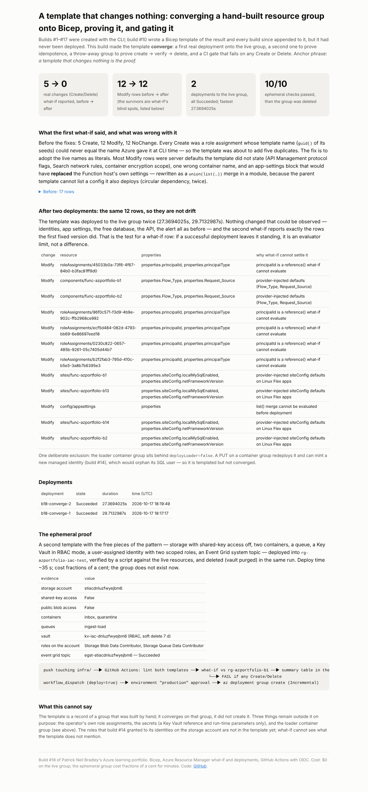

# Build #18 — A template that changes nothing: converging a hand-built resource group onto Bicep

**Live page:** https://stazportfoliob1.z14.web.core.windows.net/build-18-infra-as-code/
**Anchor phrase:** *a template that changes nothing is the proof.*

## The problem

Builds #1–#17 created their resources with the CLI. Build #10 wrote `infra/main.bicep` to describe the result and every later build appended to it — but the template had never been **deployed**. A template nobody deploys is documentation that drifts. This build made it real:

1. **Converge** — fix every what-if row that was a template error, until what-if reports no Creates or Deletes against the live group.
2. **Deploy** — run `az deployment group create --mode Incremental` against `rg-azportfolio-b1`, twice. The second run is the idempotence test.
3. **Prove create → verify → delete** — a second, free-only template deployed into a throw-away group, checked by a script, deleted (vault purged) in the same run.
4. **Gate** — GitHub Actions: lint + what-if on every push touching `infra/`, fail on any Create/Delete; deploy only by hand behind an environment approval.

## Why not "deploy everything into a second group"?

Checked before the plan: the free SQL database, AI Search free and Language F0 are **one per subscription**, so a second copy of the estate would create a *paid* SQL database and fail on the other two; Flex plan creates were also throttled. Converging on the live group is the free version of the same skill.

## What what-if said, and what was actually wrong

| Before | After two deployments |
|---|---|
| **5 Create** — all role assignments: `guid()` of the template's seeds can never equal the name Azure gave at CLI time, so the template would have added five duplicates | **0** — adopted the live assignment names as literals |
| **12 Modify** — server defaults not stated (APIM protocol flags, Search network rules, container encryption scope, ACI provisioning timeout); `reference()` storage URLs; a wrong container name; alert criterion named `free-limit` vs live `cond0`; **an app-settings block that would have replaced the Function host's own settings** | **12 Modify, all evaluator limits** — `principalId` via `reference()`, provider-injected defaults (`Flow_Type`, `localMySqlEnabled`), and the `list()` merge. The test: a row that survives a successful deployment is not drift. |

The app-settings fix took three tries: a `sites/config appsettings` resource **replaces** the whole bag, so it must be `union(live, new)`; the parent template can't `list()` a config it also deploys (circular dependency, twice — once inline, once inside a module); the working shape reads `list()` in the parent and passes it as a `@secure()` parameter to a module that writes the union (`infra/appsettings-merge.bicep` in build #10).

One deliberate exclusion: the loader container group sits behind `deployLoader=false`. A PUT on a container group can mint a new managed identity (build #14) and orphan its SQL user.

## The ephemeral proof

`infra/ephemeral.bicep`: storage (shared-key access **off**, no public blobs, TLS 1.2), `inbox`/`quarantine` containers, an `ingest-load` queue, a Key Vault in RBAC mode (soft delete 7 days), a user-assigned identity with two scoped data roles, an Event Grid system topic. `infra/run_ephemeral.ps1` creates `rg-azportfolio-iac-test`, deploys (~35 s), gathers evidence through the **management plane** (shared key is off and the deployer has no data role), runs `verify_ephemeral.py` (10 checks), then deletes the vault, purges it, and deletes the group — whatever the verdict. Evidence: `data/ephemeral_evidence.json`.

## The gate

`.github/workflows/infra.yml` — lint both templates; what-if against the live group with a change-count table in the run summary; **fail on any Create or Delete**; `deploy` job only on `workflow_dispatch` with `deploy=true`, behind the `production` environment. The build #3 OIDC identity was granted **Contributor + User Access Administrator on the resource group only** (role assignments need UAA). Operator email comes from a repository *variable*, not the repo.

## What it cost

$0 on the live group (converging changed nothing billable). The ephemeral group: a storage account and a vault for minutes — fractions of a cent. $10 alert in place.

## What went wrong

1. **Five role-assignment duplicates were one `az deployment group create` away.** what-if said "Create"; build #10's README called it a lesson; nobody had ever deployed. Now fixed by name.
2. **Circular dependency, twice**, merging app settings (above).
3. **`$pid` is read-only in PowerShell** — the first verify step died on a variable name.
4. **`ConvertTo-Json` wraps arrays as `{value, Count}`** (build #14's lesson) — the verifier now unwraps.
5. **Data-plane listing fails when shared key is off** and the caller has no data role → list containers/queues through ARM.
6. **A deleted storage account's name stays reserved** → per-run suffix from `utcNow()` (only allowed as a parameter default).
7. **Soft-deleted vaults linger 7 days** → explicit delete + purge in the clean-up.
8. **Windows PowerShell: with `$ErrorActionPreference='Stop'`, a native command's stderr warning throws** — it killed the `finally` block after the vault delete and before the group delete, leaving the group behind. Clean-up now runs with `Continue`.

## Lessons

1. **A template that changes nothing is the proof.**
2. **A what-if row that survives a successful deployment is an evaluator limit, not drift.**
3. **Adopt live names; don't regenerate them.**
4. **`appsettings` replaces; merge or lose the host's settings.**
5. **Clean-up must not be interruptible.**
6. **Grant the CI identity on the group, not the subscription.**

## Files

| Path | What |
|---|---|
| `../build-10-va-access/infra/main.bicep` | the converged template (live role-assignment names, stated defaults, name-built URLs, `deployLoader` guard) |
| `../build-10-va-access/infra/appsettings-merge.bicep` | merge module |
| `infra/ephemeral.bicep`, `infra/run_ephemeral.ps1`, `infra/verify_ephemeral.py` | the throw-away proof |
| `../.github/workflows/infra.yml` | the gate |
| `data/whatif_before.json`, `data/whatif_after.json`, `data/deployments.json`, `data/ephemeral_evidence.json` | evidence |
| `build_findings.py`, `findings.html`, `findings.png` | the page |
