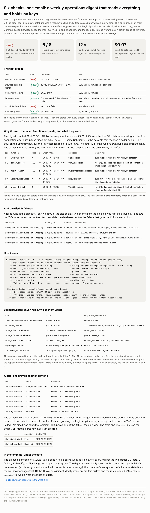

# Build #19: Six checks, one email — a weekly operations digest that reads everything and holds no keys

**Anchor phrase: six checks, one email, no keys.**

Live page: https://stazportfoliob1.z14.web.core.windows.net/build-19-ops-digest/

## The problem

Build #12 put one alert on one number (the free SQL limit). Eighteen builds later there are four Function apps, a data API, an event-driven ingestion pipeline, two GitHub pipelines, a free SQL database with a monthly ceiling and a free ADX cluster that expires. Nobody looks at all of them every week. This build asks every one of them the same question once a week and sends one red/amber/green email.

**Answer:** the first digest (Sun 18 Oct 2026, 00:38 UTC) came back **RED**, and it was right. All six checks answered: Function runs 507 with 21 failed; GitHub 44 runs with 4 failed; SQL 19% of the free limit; $0.07 spent of the $10 alert; ingestion at baseline; ADX 363 days left. Of the failed Function requests, 11 were the free database waking from auto-pause, and the rest were this week's own build-and-break testing. It also turned up something that hadn't been noticed: the data API answers a paused database with **HTTP 500**, not 503 with Retry-After.



## Azure services used and why

| Service | Tier / cost | Why |
|---|---|---|
| Logic Apps (Consumption) `la-azportfolio-digest`, system-assigned identity | pay per action; ~25 actions a week → $0.00 | schedule, parallel reads, red/amber/green logic, no code to host |
| Azure Communication Services Email: `ecs-azportfolio` + Azure-managed domain + `acs-azportfolio` | $0.00025 per email | sends with an Entra token; no SMTP password, no mailbox sign-in |
| Azure Monitor metric alerts ×5 (four Function apps, the digest itself) | 6 of 10 free alert time series used → $0 | a failure gets an email the same hour, not on Monday |
| Blob container `opsdigest` (existing storage account) | KB → $0 | `digest/YYYY-MM-DD.json` history and `latest.json` for week-over-week |
| Cost Management query API | free | month-to-date cost against the $10 budget alert |
| Log Analytics query (existing workspace) | free reads | AppRequests: runs and failures per Function app |
| Bicep: `infra/digest.bicep` as a module of `build-10-va-access/infra/main.bicep` | $0 | build #18's pipeline what-ifs it on every push |

**Cost: about $0.0003 for the first run and its email.** Subscription month-to-date: $0.07. The $10 budget alert is unchanged.

## Architecture

```
Recurrence (Mon 13:00 UTC) ──► la-azportfolio-digest  (Logic App, system-assigned identity)
   │  eight reads in parallel, each an Entra token for the Logic App's own identity
   ├─ ARM: action group ag-azportfolio-ops ......... recipient (secure inputs/outputs)
   ├─ ARM → Log Analytics: AppRequests, 7 days ...... runs and failures per Function app
   ├─ ARM metrics: free_amount_consumed ............. SQL free limit
   ├─ Cost Management query, MonthToDate ............ cost vs the $10 alert
   ├─ Blob list quarantine/, deadletter/; queue metadata ingest-load-poison
   ├─ GitHub REST (public) .......................... workflow runs, 7 days
   └─ Blob opsdigest/latest.json .................... last week
   ▼
 Metrics → Status → Digest ──► Blob opsdigest/digest/YYYY-MM-DD.json + latest.json
                         └──► ACS Email ──► operator inbox
```

A source that fails becomes UNKNOWN and the email still goes. A failed run fires `alert-digest-failed`.

## Least privilege

| Role | Scope | Why |
|---|---|---|
| Communication and Email Service Owner | `acs-azportfolio` | send |
| Monitoring Reader | `rg-azportfolio-b1` | SQL metric; read the recipient at run time |
| Storage Blob Data Reader | containers `quarantine`, `deadletter` | gate outcomes |
| Storage Queue Data Reader | queue `ingest-load-poison` | poison count |
| Storage Blob Data Contributor | container `opsdigest` | write history |
| Log Analytics Reader | default workspace | Function runs |
| Cost Management Reader | subscription | cost |

The last two are outside the resource group. They're in `infra/sub-roles.bicep` and the operator deploys them, because the GitHub identity is limited to `rg-azportfolio-b1` on purpose.

## Files

| File | What it does |
|---|---|
| `infra/workflow.json` | the Logic App definition (loaded by Bicep with `loadJsonContent`) |
| `infra/digest.bicep` | ACS, the Logic App, the container, six roles, five alerts |
| `infra/sub-roles.bicep`, `infra/workspace-reader.bicep` | the two reads outside the group |
| `infra/whatif_digest.ps1` | compile and preview only |
| `snapshot.ps1` | read-only: runs, failures, GitHub failures, alerts, what-if → `data/` (names and counts only) |
| `build_findings.py` | renders `findings.html` from `data/` |

## What I learned

1. **A Recurrence trigger with a schedule and no `startTime` fires the moment it is created.** That run happened before Azure finished granting the roles: every read returned 403, the run failed, and `alert-digest-failed` emailed. So the alert proved itself on day one. The fix is one line.
2. **Logic App workflow parameters are strictly typed.** A Bicep `int` passed to a `Float` parameter fails template validation. Declare what you pass.
3. **Pick the narrower door.** Reading the ledger through the #13 API meant fetching a function key, which needs write access to the Function app. Reading the three storage counts directly needs data-reader roles only.
4. **Don't put the recipient in the template.** The Logic App reads the email address from the action group at run time, and that action has secure inputs/outputs. The address isn't in the template, the workflow, run history or the repo.
5. **A query routed through ARM comes back in a different shape.** The Log Analytics query endpoint used through ARM returns `Columns`/`Rows`/`ColumnName`, not `columns`/`rows`/`name`.
6. **A red that's true is the point.** The first digest was red for real reasons, and one of them was a defect (500 instead of 503 on a paused database). The "any failure = red" line gets revisited after one quiet week, not before.

## Clean up (when the portfolio is retired)

```powershell
az logic workflow delete -g rg-azportfolio-b1 -n la-azportfolio-digest --yes
az monitor metrics alert delete -g rg-azportfolio-b1 -n alert-digest-failed   # and alert-fn-failures-b1/b2/b13/b14
az resource delete -g rg-azportfolio-b1 -n acs-azportfolio --resource-type Microsoft.Communication/communicationServices
az resource delete -g rg-azportfolio-b1 -n ecs-azportfolio --resource-type Microsoft.Communication/emailServices
```
Then remove the `b19Digest` module from `main.bicep`, or the next deploy will recreate them.

Non-commercial learning project on Azure for Students. Built with Claude.
