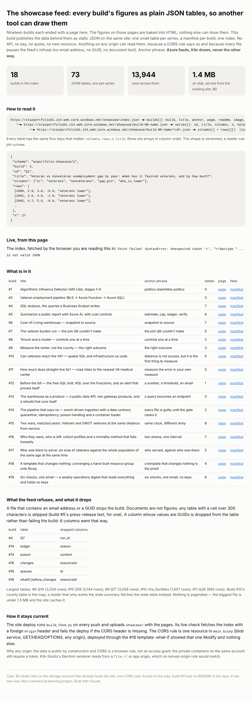

# Build #22: The showcase feed — every build's figures as plain JSON tables, so another tool can draw them

**Anchor phrase: Azure feeds, Kiln draws, never the other way.**

Live page: https://stazportfoliob1.z14.web.core.windows.net/build-22-showcase-feed/
Feed: https://stazportfoliob1.z14.web.core.windows.net/showcase/index.json

## The problem

Nineteen builds each ended with a findings page. The figures on those pages are baked into HTML, so nothing else can draw them: not the analyst page on patrickneilbradley.com, not Kiln Studio, which already vendors the website's chart components. The plan for the website side had always been *portfolio → results → Kiln → website*, one way, with no Kiln code or data in this repo. This build is the "→": the results, published in a shape a chart tool can read without knowing anything about the build that made them.

**Answer:** 18 builds, 73 tables, 13,944 rows, 1.4 MB of static JSON under `showcase/` on the existing site, rebuilt on every push, readable from any origin. Cost $0.



## Azure services used and why

| Service | Tier / cost | Why |
|---|---|---|
| Blob static website on `stazportfoliob1` (existing) | $0 | the feed is static files next to the pages; no API, no key, no quota |
| A CORS rule on the blob service (`main.bicep`) | $0 | a browser on another origin (the website, Kiln's Electron renderer) may read it |
| GitHub Actions `deploy-site.yml` (existing) | $0 | runs `build_feed.py` on every push; live check fetches the index with a foreign `Origin` and fails if CORS is missing |

**Not used, on purpose:** the build #13 API. Its public product is capped at 2,000 calls a day across all callers; a chart on a web page would spend that in an afternoon. Static files have no limit and cache.

## The shape (`azportfolio-showcase/1`)

```
showcase/index.json                 builds[]: build, title, anchor, page, readme, image, manifest, series_count
showcase/build-NN-name.json         series[]: id, title, columns, n, bytes, url
showcase/build-NN-name/<id>.json    { schema, build, id, title, columns[], rows[][], n, source, dropped_columns, generated_at, commit }
```

Rows are arrays in column order. A reader pins `schema` and reads `columns`/`rows`. Example:

```js
const idx = await (await fetch('https://stazportfoliob1.z14.web.core.windows.net/showcase/index.json')).json();
const man = await (await fetch(idx.builds.find(b => b.build === 15).manifest)).json();
const t   = await (await fetch(man.series.find(s => s.id === 'R1_bins').url)).json();
// t.columns = ['war','cohort','bin','n','n_eff','part','part_se','unemp_rate','unemp_se']; t.rows[0] = [...]
```

## What the feed refuses

- A file containing an **email address or a GUID stops the build** (the same rule the site gate enforces).
- A **column of GUIDs is dropped**, not published (run ids, resource ids): five columns across four builds.
- **Documents are not figures:** any table with a cell over 300 characters is skipped (build #5's press-release text).
- Only **committed** files under each build's `data/` are read (`git ls-files`), so nothing ignored can leak in.

## How it runs

```
push to main ─► deploy-site.yml ─► build_feed.py . dist/showcase ─► upload-batch to $web ─► live checks:
                                                                      index.json has the schema; a request with
                                                                      Origin: https://patrickneilbradley.com gets
                                                                      Access-Control-Allow-Origin back
```

## What I learned

1. **Publish the data, not the picture.** A figure baked into HTML is a dead end; a table with named columns is a starting point for any tool.
2. **The cheapest API is a file.** Static JSON on a site that already exists beats a gateway with a daily cap, for public read-only data.
3. **CORS is a browser rule, not an access grant.** `*` on public data grants nothing; the private containers on the same account still need a token. Kiln's renderer has no named origin to allow anyway.
4. **The refusal belongs in the generator.** The feed cannot publish an email or a GUID because the script that writes it checks every byte first; the site gate is the second line, not the first.
5. **An inventory finds gaps.** Walking every build found that #11 had no README in the repo. It does now.

## Files

| File | What it does |
|---|---|
| `build_feed.py` | repo → `showcase/` (index, manifests, tables); refuses emails/GUIDs; drops GUID columns |
| `build_findings.py` | runs the feed into a temp folder and renders this build's page from the result |

## Clean up

Nothing to delete. To stop publishing the feed: remove the `build_feed.py` step and the two `showcase` checks from `deploy-site.yml`, and the `blobServiceCors` resource from `main.bicep` (the next deploy clears the rule).

Data: each build's own committed results (public domain or ODbL sources, see the build). Non-commercial learning project. Built with Claude.
